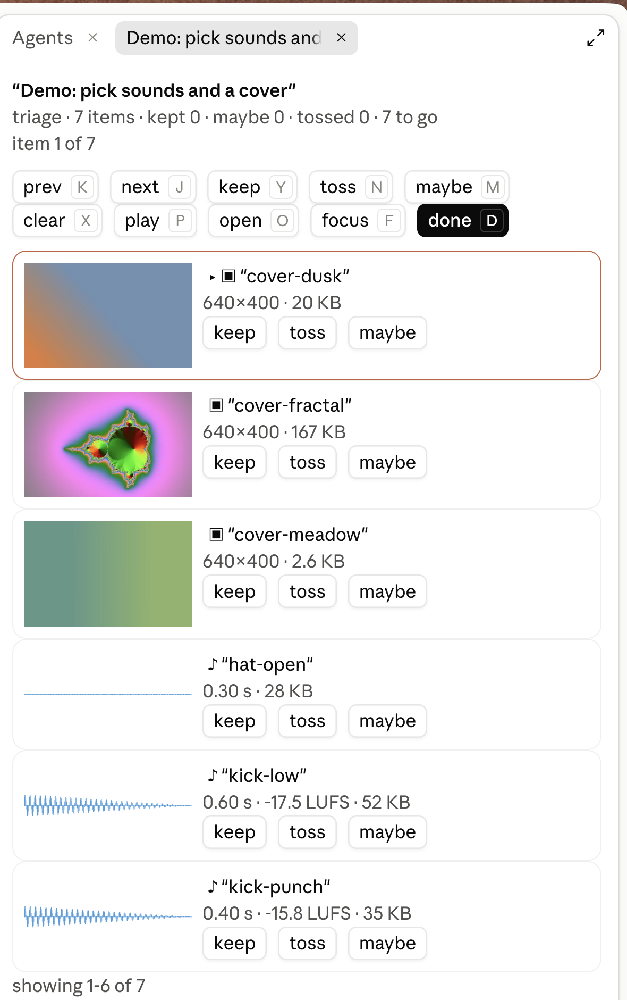
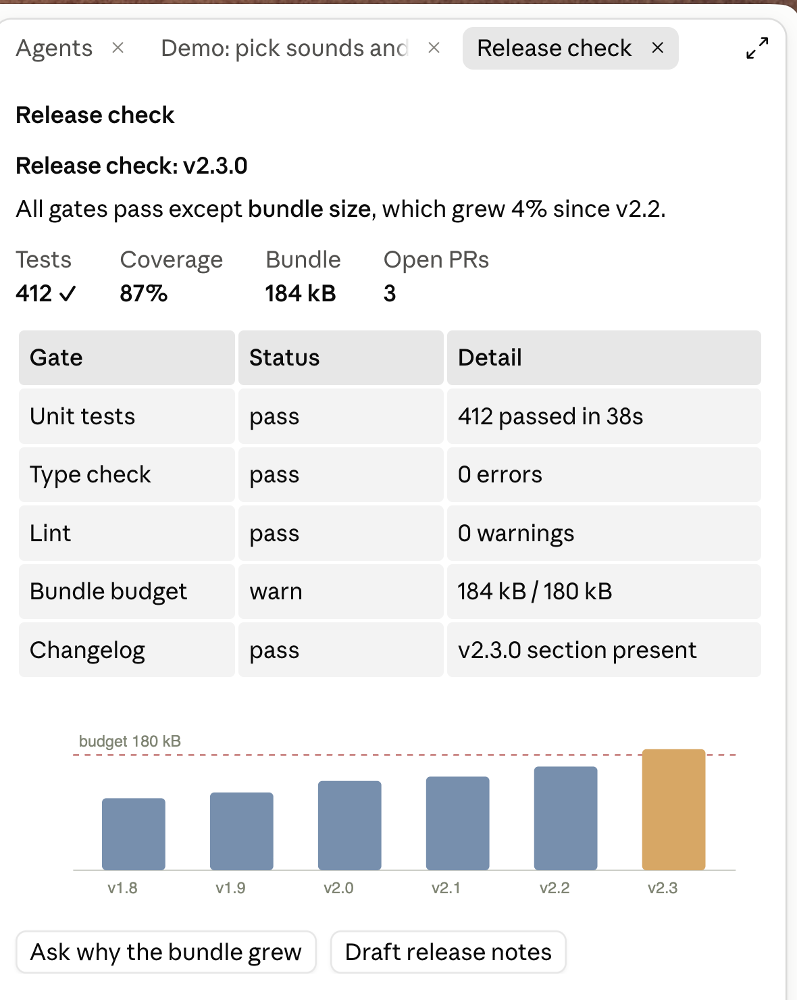
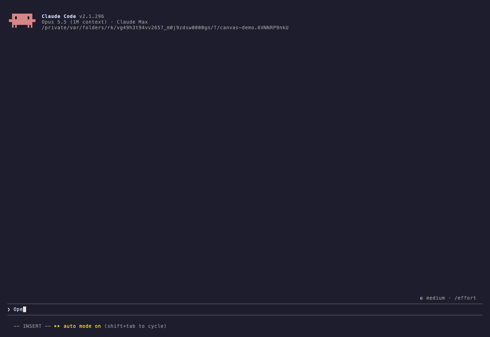

# canvas

[](https://github.com/algonormative/canvas/actions/workflows/ci.yml)
[](https://github.com/algonormative/canvas/releases/latest)
[](LICENSE)
[](#install)
[](https://code.claude.com/docs/en/plugins/mods/overview)
[](#install)

A Claude Code mod that gives Claude panes it can draw on demand, and a panel for
curating sets of media.

| `curate`: a set of sounds and images to triage | `show`: a pane Claude drew |
|---|---|
|  |  |

In a terminal the same pane draws as text, with a card for each item; pictures and waveforms need the desktop app ([demo/demo.tape](demo/demo.tape), recorded with [VHS](https://github.com/charmbracelet/vhs)):



- **`show` tool.** Claude opens a persistent, live-updating pane beside the chat and
  fills it with panels: markdown, stat tiles, tables, SVG pictures, a media set, and
  action buttons. Calling `show` again with the same pane id updates that pane in
  place. A pane can also refresh itself on a timer by re-running one of your
  allowlisted commands.
- **`curate` tool.** Claude hands you a set of files (audio, images, video, SVG,
  PDFs, text, or URLs) to go through. Each item gets a preview that fits the pane,
  and you keep, toss, maybe, pick or rate them with keys or buttons. Your verdicts
  are written to a `.curate.json` set file, and the result comes back to Claude as a
  prompt when you press Done (for pick-one, the moment you pick).
- **`/canvas`** lists open panes; `/canvas close <id>` closes one.

Nothing in the mod calls a model. Buttons and refresh never run arbitrary commands:
they run only commands you have named in an allowlist file you own.

## Install

Add the marketplace once, then install from it:

```
/plugin marketplace add algonormative/claude-plugins
/plugin install canvas@algonormative
```

Or install it from this repository alone:

```
/plugin install canvas --marketplace algonormative/canvas
```

Type these at the prompt of a terminal `claude` session. A mod installed at the user
scope also loads in the desktop app's Code tab. Outside a session the same works as
`claude plugin marketplace add ...` and `claude plugin install ...`.

Requires a Claude Code build with function-hook mods (2.1.295 or newer). The mod API
is early access and may change between releases.

### Install the CLI

The mod shells out to two commands, `canvas-preview` and `canvas-set`, which must be on
your `PATH`. They come from the Python package in `cli/` (Python 3.11 or newer):

```sh
uv tool install "git+https://github.com/algonormative/canvas#subdirectory=cli"
# or
pipx install "git+https://github.com/algonormative/canvas#subdirectory=cli"
```

Without them, `curate` reports that `canvas-set` could not be run, and media panels
show no previews.

Previews use host tools when they are present and fall back to simpler previews when
they are not. Nothing else needs installing for images, SVG and text.

| Tool | Enables | Without it |
|---|---|---|
| `ffmpeg` | audio waveforms and clips, video poster frames and clips | audio and video show as a plain card with file facts |
| `ffprobe` (ships with ffmpeg) | duration, codec and dimension facts for audio and video | the file is shown as a card |
| `qlmanage` (macOS Quick Look) | thumbnails for PDFs, and for images or documents Pillow cannot read | those files show as a card |

Container tags (title, artist, comments) are never copied into previews or shown to
Claude, since they are attacker-controlled text.

## The command allowlist

Buttons with `run`, and a pane's `refresh`, name a command; Claude never sends a
command line. The names resolve through a JSON file that only you write. The mod never
creates or edits it, and Claude can neither read nor change it.

The default location is `~/.config/canvas/commands.json`. Set the `commandsFile` option
to use another path. **A missing, unreadable or malformed file allows nothing**: buttons
that name a command draw as disabled "not allowed" buttons.

Each entry maps a name to `{ "argv": [...], "cwd": "..." }`. `cwd` is optional and may
start with `~/`. The command is run as an argv list, never through a shell.

```json
{
  "build-check": { "argv": ["npm", "run", "build-check"], "cwd": "~/projects/demo" },
  "disk": { "argv": ["df", "-h", "/"] }
}
```

A command used for `refresh` must print a JSON array on stdout, each element
`{ "index": n, "panel": { ... } }`, which replaces panel `n` of the pane. Refresh runs
no more often than every 5 seconds.

## Options

Set them with `/plugin configure canvas@algonormative`. They are stored under
`pluginConfigs` in `~/.claude/settings.json`.

| Option | Default | What it does |
|---|---|---|
| `commandsFile` | `~/.config/canvas/commands.json` | JSON file mapping command names to `{ argv, cwd? }`. Canvas buttons and refresh run a command only by a name listed here; a missing file allows nothing |

## Set files

`curate` with `items` writes a set file under `~/.cache/canvas/sets/`. You can also make
one yourself and pass it as `set`:

```sh
canvas-set new --title "Kick candidates" --mode triage -o kicks.curate.json -- kick-*.wav
canvas-set show kicks.curate.json
canvas-set validate kicks.curate.json
```

Modes are `pick-one`, `pick-many`, `triage` (keep, maybe, toss; the default) and
`rate` (1 to 5). Each item's verdict is stored in the file, so a session can be
resumed or edited outside the pane. `canvas-preview <path> --json` renders one preview
on its own.

## Develop

The mod is in `mod/`, the CLI in `cli/`. With a Claude Code build that has mod support:

```sh
claude plugin validate .      # the marketplace
claude plugin validate mod
claude plugin test mod
```

The CLI's tests generate their media fixtures with `ffmpeg` and `sox`, so install both:

```sh
cd cli && uv run pytest
```

Tests that need Quick Look skip where it cannot make thumbnails. The test suites never
call a network service.

### Re-record the demo

`demo/demo.tape` records `demo/terminal.gif` with [VHS](https://github.com/charmbracelet/vhs) in your own logged-in `claude`. To keep your other plugins out of the recording, give it a settings file that turns every installed plugin off except this one:

```bash
python3 - > /tmp/canvas-demo-settings.json <<'EOF'
import json, os
s = json.load(open(os.path.expanduser("~/.claude/settings.json")))
on = {n: n.split("@")[0] == "canvas" for n in s.get("enabledPlugins", {})}
out = {"enabledPlugins": on, "theme": "dark", "statusLine": {"type": "command", "command": "true"}}
print(json.dumps(out))
EOF
DEMO_SET="$(demo/setup.sh)" DEMO_SETTINGS=/tmp/canvas-demo-settings.json vhs demo/demo.tape
```

`demo/setup.sh` needs ffmpeg and `canvas-set` (see [Install the CLI](#install-the-cli)).

The settings file only switches plugins for the recording; your own `settings.json` is untouched. Look through the GIF before you publish it: anything your session prints (paths, task titles) ends up in it.

## License

MIT. See [LICENSE](LICENSE).
